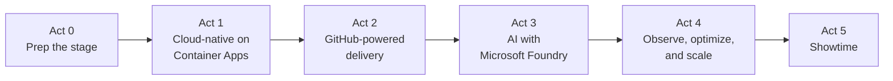
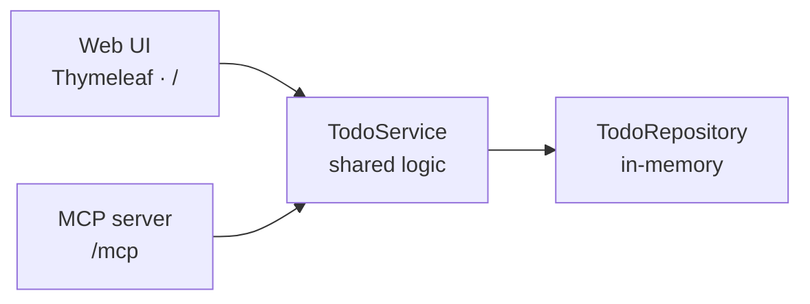
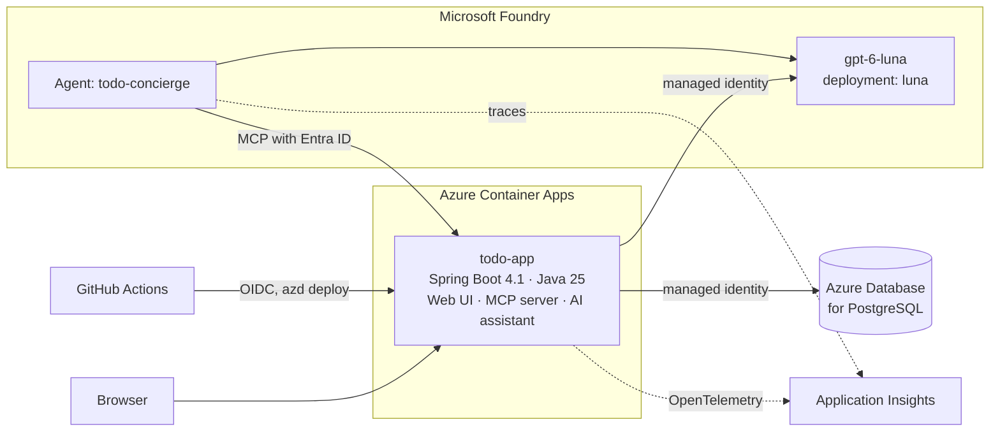

# Modernize for what's next: Java on Azure Container Apps → AI with Microsoft Foundry

Companion repo for a live **Microsoft Reactor** session. One Spring Boot app goes from a local sample to a cloud-native, AI-enabled, production-ready service on Azure, and every step is a GitHub issue.

> Modernizing an application is more than moving it to the cloud—it creates the foundation for what comes next. In this session, we'll take a modern application from cloud-native architecture and GitHub-powered development workflows through to an AI-enabled experience with Microsoft Foundry. Along the way, we'll explore how managed identity, automation, observability, and cost-aware AI patterns help you move from experimentation to scalable, production-ready innovation.

**Stack:** Java 25 · Spring Boot 4.1 · Spring AI 2.0 · Azure Container Apps · Azure Database for PostgreSQL · Microsoft Foundry (GPT-6 Luna) · GitHub Actions · GitHub Copilot

> [!NOTE]
> This repo is built in public, issue by issue. `main` holds the **baseline** app today; follow the [session roadmap](https://github.com/roryp/java-modernization-foundry/issues/1) to see what lands next.

## The journey



## Where we start

The Todo app from [microsoft/github-copilot-java-mcp-demo](https://github.com/microsoft/github-copilot-java-mcp-demo): a Thymeleaf web UI and a Spring AI **MCP server** that share one `TodoService`.



Its README is honest about why it isn't production-ready: in-memory storage, unauthenticated MCP mutation tools, and detailed Actuator health. That list is the start of the modernization backlog.

## Where we end up



## How the abstract maps to the demo

| Theme | Steps |
|---|---|
| Cloud-native architecture | [1.2](https://github.com/roryp/java-modernization-foundry/issues/5), [1.3](https://github.com/roryp/java-modernization-foundry/issues/6), [1.4](https://github.com/roryp/java-modernization-foundry/issues/7) |
| GitHub-powered development workflows | [0.1](https://github.com/roryp/java-modernization-foundry/issues/2), [2.1](https://github.com/roryp/java-modernization-foundry/issues/10), [2.2](https://github.com/roryp/java-modernization-foundry/issues/11), [2.4](https://github.com/roryp/java-modernization-foundry/issues/13), [2.5](https://github.com/roryp/java-modernization-foundry/issues/14) |
| AI-enabled experience with Microsoft Foundry | [3.1](https://github.com/roryp/java-modernization-foundry/issues/15), [3.3](https://github.com/roryp/java-modernization-foundry/issues/17), [3.4](https://github.com/roryp/java-modernization-foundry/issues/18) |
| Managed identity | [1.5](https://github.com/roryp/java-modernization-foundry/issues/8), [2.3](https://github.com/roryp/java-modernization-foundry/issues/12), [3.1](https://github.com/roryp/java-modernization-foundry/issues/15), [3.4](https://github.com/roryp/java-modernization-foundry/issues/18) |
| Automation | [1.4](https://github.com/roryp/java-modernization-foundry/issues/7), [2.3](https://github.com/roryp/java-modernization-foundry/issues/12), [3.6](https://github.com/roryp/java-modernization-foundry/issues/20) |
| Observability | [4.1](https://github.com/roryp/java-modernization-foundry/issues/21), [4.2](https://github.com/roryp/java-modernization-foundry/issues/22) |
| Cost-aware AI patterns | [4.2](https://github.com/roryp/java-modernization-foundry/issues/22), [4.3](https://github.com/roryp/java-modernization-foundry/issues/23), [4.4](https://github.com/roryp/java-modernization-foundry/issues/24) |
| From experimentation to production-ready | [1.6](https://github.com/roryp/java-modernization-foundry/issues/9), [3.5](https://github.com/roryp/java-modernization-foundry/issues/19), [3.6](https://github.com/roryp/java-modernization-foundry/issues/20), [4.5](https://github.com/roryp/java-modernization-foundry/issues/25) |

## Roadmap

Every step is an issue with tasks, acceptance criteria, and on-stage notes. The [roadmap issue](https://github.com/roryp/java-modernization-foundry/issues/1) tracks progress, and the timed run of show is in [docs/session-plan.md](docs/session-plan.md).

### Act 0 · Prep the stage

Repo, Copilot cloud agent, and dev environment ready before rehearsals. Not shown live.

| Step | Issue | Stage |
|---|---|---|
| 0.1 | [Prepare the repo for the Copilot cloud agent](https://github.com/roryp/java-modernization-foundry/issues/2) | 🧰 prep |
| 0.2 | [Add a dev container so attendees can follow along in Codespaces](https://github.com/roryp/java-modernization-foundry/issues/3) | 🧰 prep |

### Act 1 · Cloud-native on Azure Container Apps

Take the Todo app from a laptop to a stateless, passwordless container on Azure Container Apps, provisioned with azd.

| Step | Issue | Stage |
|---|---|---|
| 1.1 | [Assess cloud readiness with GitHub Copilot app modernization](https://github.com/roryp/java-modernization-foundry/issues/4) | 🎬 on stage, ~2 min |
| 1.2 | [Containerize the app for Azure Container Apps](https://github.com/roryp/java-modernization-foundry/issues/5) | 🧰 prep |
| 1.3 | [Externalize state: persist todos in PostgreSQL](https://github.com/roryp/java-modernization-foundry/issues/6) | 🧰 prep |
| 1.4 | [Provision with azd and Bicep: Container Apps, ACR, PostgreSQL, and monitoring](https://github.com/roryp/java-modernization-foundry/issues/7) | 🎬 on stage, ~4 min |
| 1.5 | [Go passwordless: managed identity for ACR and PostgreSQL](https://github.com/roryp/java-modernization-foundry/issues/8) | 🎬 on stage, ~2 min |
| 1.6 | [Production defaults: lock down Actuator and secure the MCP endpoint with Entra ID](https://github.com/roryp/java-modernization-foundry/issues/9) | 🧰 prep |

### Act 2 · GitHub-powered delivery

Issue → Copilot cloud agent → pull request → CI → secretless deployment with OIDC.

| Step | Issue | Stage |
|---|---|---|
| 2.1 | [CI: build, test, and container build on every pull request](https://github.com/roryp/java-modernization-foundry/issues/10) | 🎬 on stage, ~1 min |
| 2.2 | [Secure the supply chain: CodeQL, Dependabot, secret scanning, and push protection](https://github.com/roryp/java-modernization-foundry/issues/11) | 🎬 on stage, ~2 min |
| 2.3 | [CD: deploy to Container Apps with OIDC and no secrets in GitHub](https://github.com/roryp/java-modernization-foundry/issues/12) | 🎬 on stage, ~3 min |
| 2.4 | [Live loop: issue → Copilot cloud agent → PR → review → deploy](https://github.com/roryp/java-modernization-foundry/issues/13) | 🎬 on stage, ~4 min |
| 2.5 | [Live Copilot task: add “Clear completed” to the UI and MCP tools](https://github.com/roryp/java-modernization-foundry/issues/14) | 🎬 on stage |

### Act 3 · AI-enabled with Microsoft Foundry

Add GPT-6 Luna through Microsoft Foundry: keyless, tool-using, safe, and evaluated.

| Step | Issue | Stage |
|---|---|---|
| 3.1 | [Provision Microsoft Foundry and deploy GPT-6 Luna with azd (keys disabled)](https://github.com/roryp/java-modernization-foundry/issues/15) | 🎬 on stage, ~2 min |
| 3.2 | [Give the AI something to reason about: due dates and priority](https://github.com/roryp/java-modernization-foundry/issues/16) | 🧰 prep |
| 3.3 | [Add a Spring AI assistant powered by Luna, keyless with managed identity](https://github.com/roryp/java-modernization-foundry/issues/17) | 🎬 on stage, ~5 min |
| 3.4 | [Make the app a tool: a Foundry agent on Luna that calls the app's MCP server](https://github.com/roryp/java-modernization-foundry/issues/18) | 🎬 on stage, ~4 min |
| 3.5 | [Responsible AI: guardrails and a prompt-injection demo](https://github.com/roryp/java-modernization-foundry/issues/19) | 🎬 on stage, ~2 min |
| 3.6 | [Quality gate: evaluate the assistant and agent in CI with Foundry evaluations](https://github.com/roryp/java-modernization-foundry/issues/20) | 🎬 on stage, ~2 min |

### Act 4 · Observe, optimize, and scale

See every request end to end, measure tokens and cost, and apply cost-aware AI patterns.

| Step | Issue | Stage |
|---|---|---|
| 4.1 | [End-to-end observability: OpenTelemetry to Application Insights, plus Foundry tracing](https://github.com/roryp/java-modernization-foundry/issues/21) | 🎬 on stage, ~3 min |
| 4.2 | [AI usage and cost dashboard, alerts, and budget](https://github.com/roryp/java-modernization-foundry/issues/22) | 🎬 on stage, ~2 min |
| 4.3 | [Cost-aware AI patterns: right-size, trim, cache, and cap](https://github.com/roryp/java-modernization-foundry/issues/23) | 🎬 on stage, ~3 min |
| 4.4 | [Stretch: govern AI traffic with an API Management AI gateway](https://github.com/roryp/java-modernization-foundry/issues/24) | ⭐ stretch, ~2 min |
| 4.5 | [Stretch: load test scale-out and AI resilience](https://github.com/roryp/java-modernization-foundry/issues/25) | ⭐ stretch |

### Act 5 · Showtime

Rehearse, de-risk, deliver, and clean up.

| Step | Issue | Stage |
|---|---|---|
| 5.1 | [Run of show, checkpoint tags, and demo reset](https://github.com/roryp/java-modernization-foundry/issues/26) | 🧰 prep |
| 5.2 | [Rehearsal and pre-flight checklist](https://github.com/roryp/java-modernization-foundry/issues/27) | 🧰 prep |
| 5.3 | [Attendee resources and cost cleanup](https://github.com/roryp/java-modernization-foundry/issues/28) | 🧰 prep |

## How this repo works

- **Issues are the plan.** Each step covers why it matters, tasks, acceptance criteria, what to show on stage, and references. The [roadmap issue](https://github.com/roryp/java-modernization-foundry/issues/1) tracks every step as a sub-issue, and acts are [milestones](https://github.com/roryp/java-modernization-foundry/milestones).
- **Labels:** `on-stage` 🎬 shown live · `prep` 🧰 built before · `stretch` ⭐ if time allows · `copilot-ready` 🤖 scoped for the Copilot cloud agent · `area: *` for filtering.
- **Copilot does real work.** `copilot-ready` issues can be assigned to the Copilot cloud agent, and step [2.5](https://github.com/roryp/java-modernization-foundry/issues/14) is assigned live on stage.
- **Checkpoints.** Each finished act is tagged (`act-1-cloud-native`, and so on) so the demo can recover from any point. The `baseline` tag marks the starting app.
- **New steps** use the **Session step** issue template.

## Run the baseline locally

Requires JDK 25. You don't need Maven installed; the repo includes the Maven Wrapper.

```powershell
.\mvnw.cmd spring-boot:run   # Windows
```

```bash
./mvnw spring-boot:run       # macOS or Linux
```

- Web UI: http://localhost:8080
- MCP endpoint: http://localhost:8080/mcp ([`.vscode/mcp.json`](.vscode/mcp.json) connects VS Code to it)
- Health: http://localhost:8080/actuator/health
- Tests: `./mvnw test`

> [!IMPORTANT]
> The baseline is a local sample. Todos live in memory, the MCP mutation tools are unauthenticated, and Actuator returns detailed health. Don't expose it to untrusted networks. Act 1 fixes all three.

## Credits

The baseline app comes from [microsoft/github-copilot-java-mcp-demo](https://github.com/microsoft/github-copilot-java-mcp-demo), a four-part series on Java, Spring Boot, MCP, and GitHub Copilot in VS Code. MIT licensed; see [LICENSE](LICENSE).
