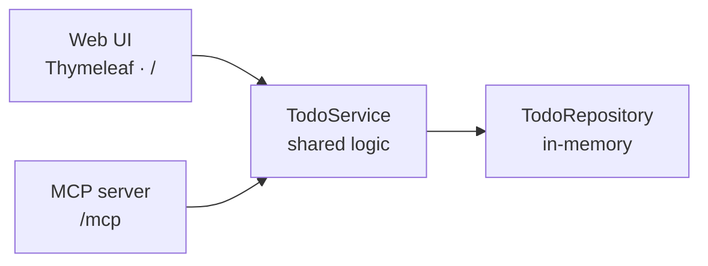
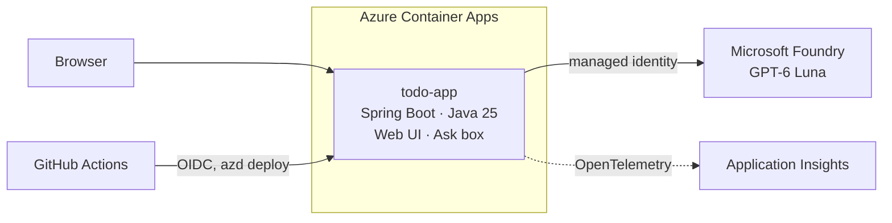

# Modernize for what's next: Java on Azure Container Apps → AI with Microsoft Foundry

Companion repo for a live **Microsoft Reactor** session: one small Spring Boot app, four short demos, and no live coding.

> Modernizing an application is more than moving it to the cloud—it creates the foundation for what comes next. In this session, we'll take a modern application from cloud-native architecture and GitHub-powered development workflows through to an AI-enabled experience with Microsoft Foundry. Along the way, we'll explore how managed identity, automation, observability, and cost-aware AI patterns help you move from experimentation to scalable, production-ready innovation.

## How the session works

Everything is built and deployed **before** the session. On stage you click and talk through four demos at a comfortable pace. The only thing you type is a question into the app's **Ask** box.

| Time | Demo | What it shows | Built in |
|---|---|---|---|
| 0:00 | Welcome and the story | Slides, and the Todo app we start from | — |
| 0:08 | **1. It runs on Azure Container Apps** | Cloud-native, automation with `azd`, managed identity (no secrets) | [Step 1](https://github.com/roryp/java-modernization-foundry/issues/7) |
| 0:18 | **2. GitHub builds and ships it** | Copilot pull requests, GitHub Actions, OIDC (no secrets in GitHub) | [Step 2](https://github.com/roryp/java-modernization-foundry/issues/12) |
| 0:28 | **3. Now it's AI** | GPT-6 Luna in Microsoft Foundry, Spring AI, keyless access | [Step 3](https://github.com/roryp/java-modernization-foundry/issues/17) |
| 0:43 | **4. Watch it and keep cost down** | Application Insights traces, token counts, cost-aware choices | [Step 4](https://github.com/roryp/java-modernization-foundry/issues/21) |
| 0:52 | Recap and Q&A | Slides | — |

The talk track and backup plan are in [docs/session-plan.md](docs/session-plan.md).

## Before the session

1. [Step 0](https://github.com/roryp/java-modernization-foundry/issues/2): get the repo ready for Copilot.
2. Steps 1 to 4: build each demo. The Copilot cloud agent can do most of the work: assign it an issue, review the pull request, and merge.
3. [Step 5](https://github.com/roryp/java-modernization-foundry/issues/26): deploy the day before, rehearse twice, and record a backup clip of each demo.

Progress is tracked in the [session plan issue](https://github.com/roryp/java-modernization-foundry/issues/1).

## Where we start

The Todo app from [microsoft/github-copilot-java-mcp-demo](https://github.com/microsoft/github-copilot-java-mcp-demo): a web page and MCP tools that share one `TodoService`, running on a laptop.

## Where we end up

## Run the app locally

Requires JDK 25. Run `./mvnw spring-boot:run` (on Windows: `.\mvnw.cmd spring-boot:run`), then open http://localhost:8080.

## Credits

The baseline app comes from [microsoft/github-copilot-java-mcp-demo](https://github.com/microsoft/github-copilot-java-mcp-demo) (MIT). See [LICENSE](LICENSE).
