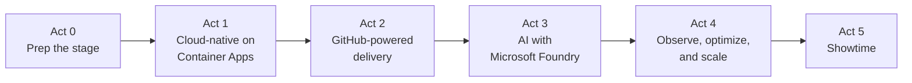
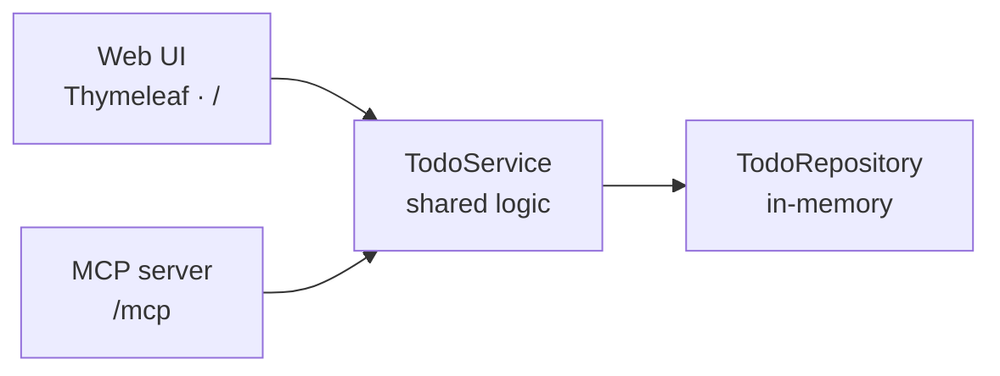
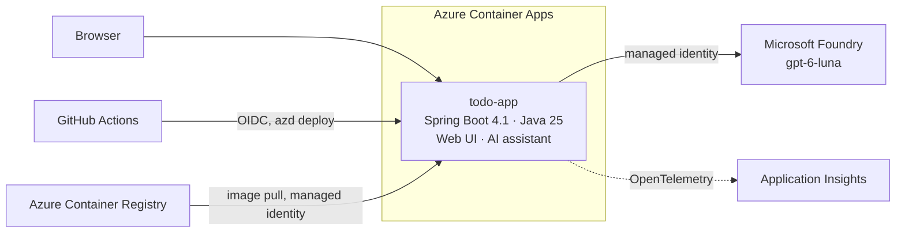

# Modernize for what's next: Java on Azure Container Apps → AI with Microsoft Foundry

Companion repo for a live **Microsoft Reactor** session. One Spring Boot app goes from a local sample to a cloud-native, AI-enabled service on Azure, and every step is a GitHub issue.

> Modernizing an application is more than moving it to the cloud—it creates the foundation for what comes next. In this session, we'll take a modern application from cloud-native architecture and GitHub-powered development workflows through to an AI-enabled experience with Microsoft Foundry. Along the way, we'll explore how managed identity, automation, observability, and cost-aware AI patterns help you move from experimentation to scalable, production-ready innovation.

**Stack:** Java 25 · Spring Boot 4.1 · Spring AI 2.0 · Azure Container Apps · Microsoft Foundry (GPT-6 Luna) · GitHub Actions · GitHub Copilot

## How the demo works

**Build it before, show it during.** The issues below are the build list. Work through them before the session; most are labeled `copilot-ready`, so the Copilot cloud agent can build them. Tag each finished act as a checkpoint.

**On stage you do four things live:**

1. Run the app locally and call its MCP tools from Copilot Chat.
2. Assign [2.3](https://github.com/roryp/java-modernization-foundry/issues/14) to the Copilot cloud agent.
3. Live-code the Spring AI assistant and ask it a question ([3.2](https://github.com/roryp/java-modernization-foundry/issues/17)).
4. Merge Copilot's pull request and watch it deploy.

Everything else is already built, so you click through it. The minute-by-minute plan is in [docs/session-plan.md](docs/session-plan.md).

## The journey



## Where we start

The Todo app from [microsoft/github-copilot-java-mcp-demo](https://github.com/microsoft/github-copilot-java-mcp-demo): a Thymeleaf web UI and a Spring AI **MCP server** that share one `TodoService`.



## Where we end up



## How the abstract maps to the demo

| Theme | Steps |
|---|---|
| Cloud-native architecture | [1.1](https://github.com/roryp/java-modernization-foundry/issues/5), [1.2](https://github.com/roryp/java-modernization-foundry/issues/7) |
| GitHub-powered development workflows | [0.1](https://github.com/roryp/java-modernization-foundry/issues/2), [2.1](https://github.com/roryp/java-modernization-foundry/issues/10), [2.2](https://github.com/roryp/java-modernization-foundry/issues/12), [2.3](https://github.com/roryp/java-modernization-foundry/issues/14) |
| AI-enabled experience with Microsoft Foundry | [3.1](https://github.com/roryp/java-modernization-foundry/issues/15), [3.2](https://github.com/roryp/java-modernization-foundry/issues/17) |
| Managed identity | [1.2](https://github.com/roryp/java-modernization-foundry/issues/7), [2.2](https://github.com/roryp/java-modernization-foundry/issues/12), [3.1](https://github.com/roryp/java-modernization-foundry/issues/15), [3.2](https://github.com/roryp/java-modernization-foundry/issues/17) |
| Automation | [1.2](https://github.com/roryp/java-modernization-foundry/issues/7), [2.2](https://github.com/roryp/java-modernization-foundry/issues/12) |
| Observability | [4.1](https://github.com/roryp/java-modernization-foundry/issues/21) |
| Cost-aware AI patterns | [4.2](https://github.com/roryp/java-modernization-foundry/issues/23) |
| From experimentation to production-ready | [1.1](https://github.com/roryp/java-modernization-foundry/issues/5), [2.1](https://github.com/roryp/java-modernization-foundry/issues/10), [4.1](https://github.com/roryp/java-modernization-foundry/issues/21) |

## Roadmap

[Roadmap issue #1](https://github.com/roryp/java-modernization-foundry/issues/1) tracks progress. Every step has tasks, acceptance criteria, and on-stage notes.

### Act 0 · Prep the stage

Get the repo ready for the Copilot cloud agent. Not shown live.

| Step | Issue | Stage |
|---|---|---|
| 0.1 | [Prepare the repo for the Copilot cloud agent](https://github.com/roryp/java-modernization-foundry/issues/2) | 🧰 prep |

### Act 1 · Cloud-native on Azure Container Apps

Containerize the Todo app and deploy it to Azure Container Apps with azd. No secrets, just managed identity.

| Step | Issue | Stage |
|---|---|---|
| 1.1 | [Containerize the app with safe cloud defaults](https://github.com/roryp/java-modernization-foundry/issues/5) | 🧰 prep |
| 1.2 | [Deploy to Container Apps with azd and Bicep, using managed identity (no secrets)](https://github.com/roryp/java-modernization-foundry/issues/7) | 🎬 on stage, ~8 min |

### Act 2 · GitHub-powered delivery

Copilot cloud agent builds a feature live, CI tests it, and GitHub Actions deploys it with OIDC.

| Step | Issue | Stage |
|---|---|---|
| 2.1 | [CI: build and test every pull request](https://github.com/roryp/java-modernization-foundry/issues/10) | 🎬 on stage, ~2 min |
| 2.2 | [CD: deploy from GitHub Actions with OIDC, no secrets in GitHub](https://github.com/roryp/java-modernization-foundry/issues/12) | 🎬 on stage, ~4 min |
| 2.3 | [Live Copilot task: add “Clear completed” (assigned on stage)](https://github.com/roryp/java-modernization-foundry/issues/14) | 🎬 on stage, ~4 min |

### Act 3 · AI-enabled with Microsoft Foundry

Add a Spring AI assistant powered by GPT-6 Luna in Microsoft Foundry, keyless with managed identity.

| Step | Issue | Stage |
|---|---|---|
| 3.1 | [Provision Microsoft Foundry and deploy GPT-6 Luna with azd (keys disabled)](https://github.com/roryp/java-modernization-foundry/issues/15) | 🎬 on stage, ~3 min |
| 3.2 | [Add a Spring AI assistant powered by Luna, keyless with managed identity](https://github.com/roryp/java-modernization-foundry/issues/17) | 🎬 on stage, ~10 min |

### Act 4 · Observe and optimize

Trace every AI call, see the tokens, and apply cost-aware patterns.

| Step | Issue | Stage |
|---|---|---|
| 4.1 | [Observability: trace every AI call in Application Insights](https://github.com/roryp/java-modernization-foundry/issues/21) | 🎬 on stage, ~4 min |
| 4.2 | [Cost-aware AI: right-size, trim, cap, cache, and budget](https://github.com/roryp/java-modernization-foundry/issues/23) | 🎬 on stage, ~5 min |

### Act 5 · Showtime

Rehearse, de-risk, deliver, and clean up.

| Step | Issue | Stage |
|---|---|---|
| 5.1 | [Demo kit: checkpoints, reset, and rehearsal](https://github.com/roryp/java-modernization-foundry/issues/26) | 🧰 prep |

### What's next (cut to keep the demo simple)

Use these as your closing "what's next" slide, or reopen any of them to bring them back: [Persist todos in PostgreSQL](https://github.com/roryp/java-modernization-foundry/issues/6), [Secure the MCP endpoint with Entra ID](https://github.com/roryp/java-modernization-foundry/issues/9), [Foundry agent calling the app's MCP server](https://github.com/roryp/java-modernization-foundry/issues/18), [Guardrails and prompt-injection demo](https://github.com/roryp/java-modernization-foundry/issues/19), [Evaluation gate in CI](https://github.com/roryp/java-modernization-foundry/issues/20).

## How this repo works

- **Issues are the plan.** Acts are milestones, and the roadmap issue tracks every step as a sub-issue.
- **Labels:** `on-stage` 🎬 shown in the session · `prep` 🧰 built before · `copilot-ready` 🤖 scoped for the Copilot cloud agent · `area: *` for filtering.
- **Checkpoints:** tags `baseline`, `act-1-cloud-native`, `act-2-github`, `act-3-foundry`, and `act-4-production` let you recover from any point in the demo.

## Run the baseline locally

Requires JDK 25. Maven isn't needed because the repo includes the Maven Wrapper.

```powershell
.\mvnw.cmd spring-boot:run   # Windows
```

```bash
./mvnw spring-boot:run       # macOS or Linux
```

- Web UI: http://localhost:8080
- MCP endpoint: http://localhost:8080/mcp. [`.vscode/mcp.json`](.vscode/mcp.json) connects VS Code to it.
- Health: http://localhost:8080/actuator/health
- Tests: `./mvnw test`

> [!IMPORTANT]
> The baseline is a local sample: todos live in memory, the MCP tools are unauthenticated, and Actuator returns detailed health. Don't expose it to untrusted networks. Act 1 adds safe cloud defaults, so health details are hidden and the MCP endpoint is off in Azure.

## Credits

The baseline app comes from [microsoft/github-copilot-java-mcp-demo](https://github.com/microsoft/github-copilot-java-mcp-demo), a four-part series on Java, Spring Boot, MCP, and GitHub Copilot in VS Code. It's MIT licensed; see [LICENSE](LICENSE).
